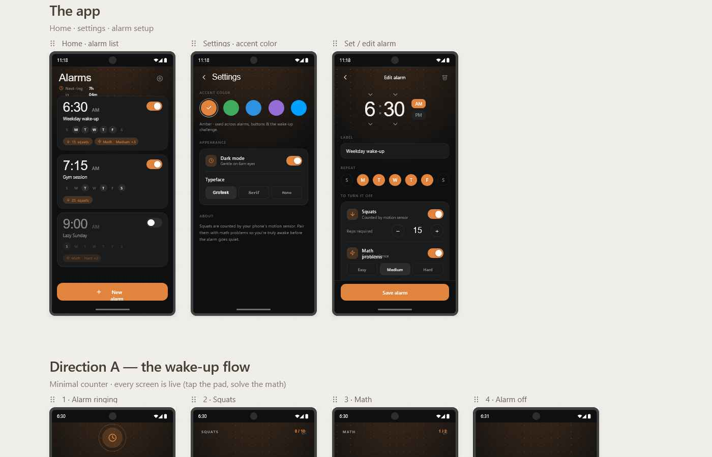
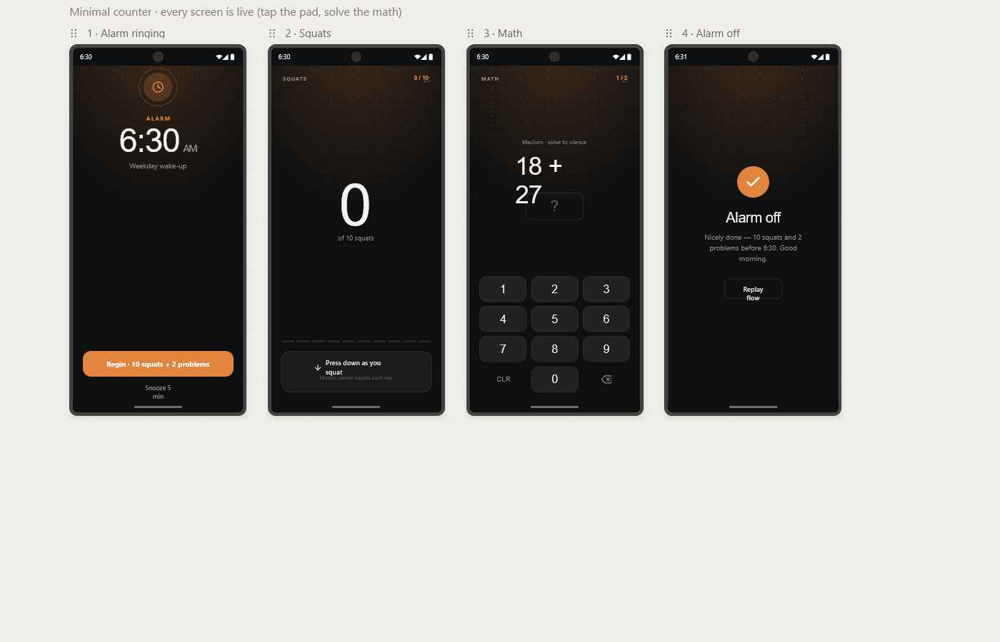

# WakeUp

An Alarmy-style alarm app for Android that won't let you go back to sleep. To
silence an alarm you have to complete **wake-up missions** — do a set number of
**squats** (counted by the phone's motion sensor) and/or solve **math problems**.
The alarm is escape-proofed: it rings full-screen over the lock screen and can't
be dismissed by backing out, going home, or disabling it in the app.

Built as a personal / sideload project. Native Kotlin + Jetpack Compose, single module.

## Screens

The UI implements a calm, monochrome-plus-accent design (dark by default — it's 6am).



The wake-up flow — ring → squats → math → done:



## Features

- **Wake-up missions** to dismiss an alarm, chained in order: squats then math.
  - **Squats** — counted by the accelerometer (no tapping). It integrates vertical
    acceleration into displacement and requires a genuine knee-bend descent, so
    jerking or shaking the phone doesn't count.
  - **Math** — Easy / Medium / Hard problems solved on an on-screen keypad, with a
    configurable count.
- **Standard alarm features** — multiple alarms, repeat days, labels, looping
  ringtone with gradual volume ramp, vibration.
- **Reliable ringing** — exact alarms via `AlarmManager.setAlarmClock`, a foreground
  service for playback, a full-screen-intent notification, boot re-arming, and
  wake-lock handling.
- **Escape-proofing** — the wake-up screen shows over the lock screen and takes over
  even when the phone is unlocked/in use; Back/Home/Recents can't dismiss it; and
  disabling a ringing alarm in the app keeps its snooze (it still rings).
- **Quality-of-life** — the ringtone goes quiet for ~10s while you're actively doing
  a mission, then nags back if you stall. Snooze (with a configurable limit).
- **Appearance** — selectable accent color (5 options), dark/light mode, and three
  typeface pairings (Grotesk / Serif / Mono). Persisted and applied live everywhere.

## Tech stack

- **Kotlin** + **Jetpack Compose** (Material 3), MVVM, single module
- **Room** (KSP) for persistence, **kotlinx.serialization** for mission params
- **Coroutines / Flow**, **Navigation-Compose**, lifecycle-aware state
- Custom design system (OKLCH accents → sRGB, bundled Google fonts, dot-grid pattern)
- minSdk 26, compile/target SDK 35 · AGP 8.7.3 · Kotlin 2.0.21 · Compose BOM 2024.10.01

## Project layout

```
app/src/main/java/com/wakeup/
  alarm/      AlarmReceiver, AlarmService, AlarmActivity, scheduling glue, RingState
  schedule/   AlarmManagerScheduler, NextTrigger, SnoozePolicy
  data/       Room entities/DAO + AlarmRepository
  domain/     Alarm / MissionParams models, RepeatDays
  mission/    SquatDetectorCore (+ AccelerometerSquatDetector), MathProblemGenerator
  settings/   SettingsStore (accent / dark / typeface)
  ui/         theme · components · list (Home) · edit · settings · firing (wake-up flow) · perms
```

## Build

Requires **JDK 17** and the **Android SDK** (platform 35, build-tools 35). Point the
build at them, then use the Gradle wrapper:

```bash
export JAVA_HOME=/path/to/jdk-17
export ANDROID_HOME=/path/to/Android/Sdk   # or set sdk.dir in local.properties

./gradlew assembleDebug          # build app/build/outputs/apk/debug/app-debug.apk
./gradlew testDebugUnitTest      # run unit tests
```

## Install

The app uses several runtime permissions; grant them on first launch (notifications,
exact alarms, **display over other apps**, and ideally disabling battery optimization).

```bash
adb install -r app/build/outputs/apk/debug/app-debug.apk
```

## License

Personal project — no license specified.
